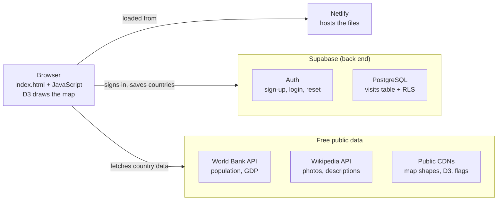

# Where I've Been

A travel map anyone can sign up for. Each person marks the countries they've visited, logs trips with dates and notes, and sees how they rank against other travelers. Every map is private to its owner.

**Live site:** https://whereihavebeen.com (also https://whereihavebeen.netlify.app, which redirects)

## Features

- **World map colored by continent.** Visited countries show in full color and the rest are pale. Double-click a country to toggle it.
- **Country pages** with a photo, the flag, capital, population, GDP, GDP per person, currency, government, main religion, languages and a short description.
- **Trips and notes** for each country, with arrival and departure dates.
- **Stats:** "X of Y countries", share of the world, continents visited, days on the road, countries visited this year, and a percentage for each continent.
- **Rank among all travelers** and your percentile, worked out without revealing anyone's countries.
- **Leaderboards** (opt-in, by screen name): all travelers, most countries this year, each continent, your home country and your home state.
- **Checklist and search** to tick countries off quickly, plus **Import a list** (paste names) and **Copy my list**.
- **Delete my account** in Profile: removes the login and all of that person's data.
- **Accounts:** email sign-up, password reset, optional Google sign-in, a screen name (defaults to the email address), and a home country, state and continent.
- About 70 small countries and islands appear as dots. Territories count toward their parent country (Hong Kong with China, Puerto Rico with the US).

## Tech stack

In one sentence: a plain JavaScript web app hosted on **Netlify**, with **Supabase** (PostgreSQL plus built-in logins) as the back end, and free public data from the **World Bank** and **Wikipedia**.

| Layer | What it uses | VB-era equivalent |
|---|---|---|
| Front end | One HTML page: CSS for the look, plain JavaScript for the logic (no framework) | VB forms and the code behind them |
| Map drawing | [D3.js](https://d3js.org) draws the world map as clickable shapes | A custom drawing control (OCX) |
| Hosting | [Netlify](https://www.netlify.com) serves the files over HTTPS | Copying the EXE to a file server |
| Database | PostgreSQL on [Supabase](https://supabase.com): one table, `visits` | SQL Server / MySQL |
| Logins | Supabase Auth: email and password, password reset, optional Google | A Users table you'd build yourself |
| Security | Row Level Security (RLS): rules inside the database so each user can only read and write their own rows | Per-user permissions, enforced in the database |
| Server logic | One SQL function, `my_travel_stats`, that works out rankings without exposing anyone's data | A stored procedure |
| Live data | [World Bank API](https://datahelpdesk.worldbank.org/knowledgebase/articles/889392) (population, GDP) and [Wikipedia REST API](https://en.wikipedia.org/api/rest_v1/) (photos, descriptions) | — |
| Other assets | Public CDNs: cdnjs and jsDelivr (D3, Supabase library, map shapes) and flagcdn.com (flags) | Shipping DLLs with your installer |

**Worth knowing:**
- **Serverless.** There's no server code to run or maintain. The browser talks straight to Supabase, and the database's security rules do the job a middle tier used to do.
- **The key in `config.js` is meant to be public.** It's Supabase's anon (publishable) key, which every visitor's browser receives anyway. The data is protected by the RLS rules. Never put the `service_role` or secret key in the website.
- **Free to run** on the free tiers of Netlify and Supabase. Costs only start with heavy use or a custom domain.

## Files

| File | What it is |
|---|---|
| `index.html` | The whole app: map, country pages, checklist, stats, sign-in and profile |
| `config.js` | Your Supabase project URL and anon key, plus the Google sign-in switch |
| `countries-data.js` | Facts that rarely change, for about 200 countries: capital, currency, government, main religion, languages |
| `schema.sql` | Creates the `visits` table, its security rules and the ranking function. Run once. |
| `stats.sql` | The ranking function on its own, for databases set up before rankings were added |
| `add-first-year.sql` | Adds the optional "Year first visited" column and updates the this-year leaderboard. Run once. |
| `delete-account.sql` | Lets users delete their own account and all their data from Profile. Run once. |
| `leaderboard.sql` | Public profiles (opt-in), the country-to-continent table, the `leaderboard()` function and percentile. Run once. |

## Data model

One table, `visits`, with one row per person per country:

| Column | Type | Notes |
|---|---|---|
| `user_id` | uuid | The signed-in user. Defaults to `auth.uid()`. |
| `country_code` | text | ISO two-letter code, e.g. `FR` |
| `visited` | boolean | |
| `trips` | jsonb | A list of `{id, from, to, note}` |
| `notes` | text | Up to 5,000 characters |
| `updated_at` | timestamptz | |

The primary key is (`user_id`, `country_code`). Screen name and home location are stored with the user's account (Supabase Auth user metadata), not in this table.

## Where the country facts come from

- **Population, GDP and GDP per person:** World Bank, the most recent year available. Fetched live and cached in the browser for 7 days.
- **Photo and description:** Wikipedia. The photo is usually of the capital city. Cached for 14 days.
- **Flag:** flagcdn.com, falling back to a flag emoji.
- **Capital, currency, government, religion, languages:** `countries-data.js`, compiled by hand in late 2026. Governments marked "military-led" or "transitional" can change quickly, so check those now and then.

---

## Setup (first time)

Budget 30–60 minutes.

### 1. Create the database (Supabase)

1. Sign up at **supabase.com** and click **New project**. Pick a name, a database password (save it somewhere) and the region closest to you.
2. Open **SQL Editor → New query**, paste in all of `schema.sql`, and click **Run**. You should see *Success*.
3. Check **Table Editor**: there should be a `visits` table with RLS turned on.

### 2. Connect the app

1. In Supabase open **Project Settings → API Keys**. Copy the **anon public** key from the **Legacy API Keys** tab (starts with `eyJ…`), or the **publishable** key (`sb_publishable_…`).
2. Copy the **Project URL** from the **Connect** button or **Settings → Data API**. Use only the base address, `https://xxxx.supabase.co`, without `/rest/v1/` on the end.
3. Paste both into `config.js` between the quote marks and save it as **plain text**. On a Mac, TextEdit needs **Format → Make Plain Text**. Each value must end on the same line it starts on.

### 3. Put it online (Netlify)

1. Sign up at **netlify.com**, go to **app.netlify.com/drop**, and drag this folder onto the page. This is only for the first time.
2. Optional: rename the site under **Site configuration → General → Change site name**.

### 4. Tell Supabase where the app lives

In Supabase open **Authentication → URL Configuration**:
- **Site URL:** `https://your-site.netlify.app`. Use `https`, with no slash at the end.
- **Redirect URLs:** add `https://your-site.netlify.app/**`.

Update both whenever the site's address changes.

### 5. Test it

1. Open the site and click **Create a new account**. Confirm your email with the link Supabase sends.
2. Tick some countries, sign out, and sign back in. They should still be there.
3. Make a second account in a private window. It should start with an empty map.
4. In Supabase, check **Authentication → Users** and **Table Editor → visits**.

### 6. Before sharing widely

- Supabase's built-in email only sends a few messages an hour. Either turn off **Confirm email** under **Authentication → Sign In / Providers → Email**, or connect an email service such as Resend under **Authentication → Emails → SMTP Settings**.
- Make the Netlify site public with **Make public**, if it's still private.

### Optional: Google sign-in

Turn on Google under **Authentication → Sign In / Providers** in Supabase (it links to Google's setup steps). Then set `GOOGLE_ENABLED: true` in `config.js` and redeploy.

## Making changes

1. Replace the changed files in this folder. Keep your own `config.js`.
2. In Netlify open your site → **Deploys** and drag the **whole folder** onto the box at the bottom. Dragging a single file replaces the whole site with just that file.
3. On the site, press **Cmd+Shift+R** (Mac) or **Ctrl+Shift+R** (Windows) to load the new version.

Saved countries and accounts live in Supabase, so redeploying never touches them. To undo a bad deploy, open an older entry under **Deploys** and click **Publish deploy**.

## Troubleshooting

| What you see | Fix |
|---|---|
| "Almost ready… isn't connected to its database yet" | Open `your-site/config.js` in the browser. It should show your real URL and key. Check that `window` is spelled right, the quotes are straight and the key is all on one line. |
| Email link goes to `localhost` or the wrong site | Fix the Site URL and Redirect URLs (step 4), then sign up again |
| "Email rate limit exceeded" | See step 6 |
| Countries don't save | Make sure `schema.sql` ran without errors and `visits` exists |
| No rank tile | Run `stats.sql` in the SQL Editor |
| "Account deletion isn't set up yet" | Run `delete-account.sql` in the SQL Editor |
| "Leaderboards aren't set up yet" | Run `leaderboard.sql` in the SQL Editor, then refresh |
| A country page stays on "Loading…" | The World Bank or Wikipedia didn't answer. Refresh, or try again later. |
